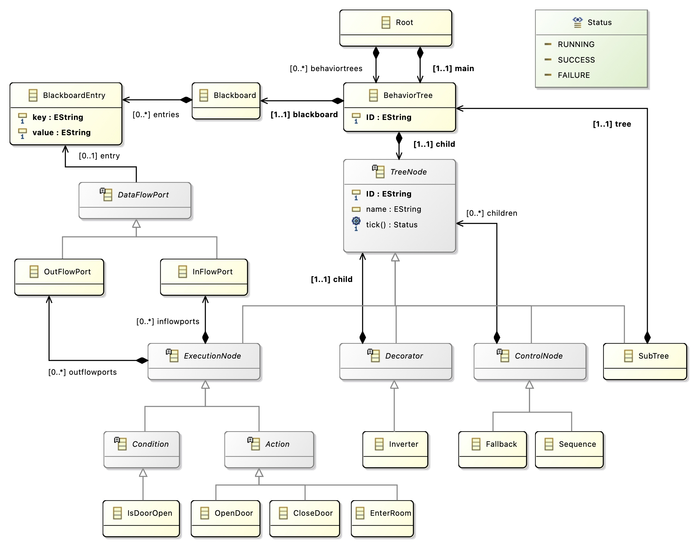
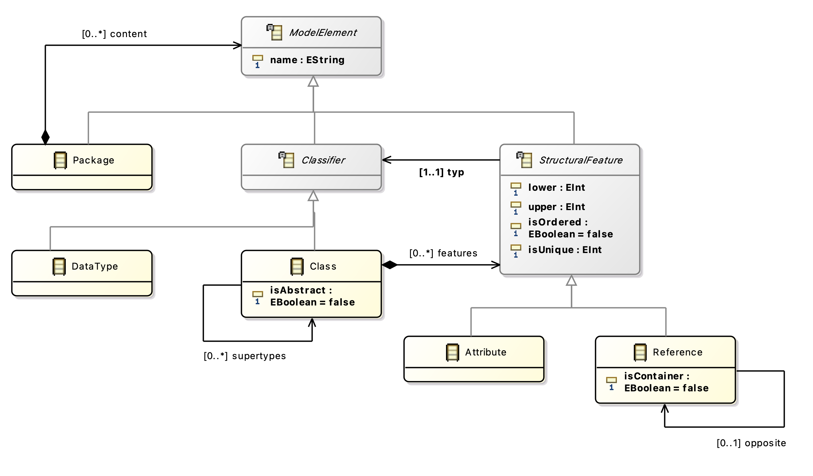
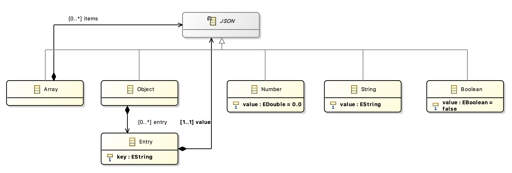

# Examples

## Running the examples

In a POSIX shell:

```sh
RUST_LOG=debug cargo run generate -vv -o <WHERE_TO_GENERATE_PROJECT> <PATH_TO_ECORE_METAMODEL>
```

## Case studies

The `example` folder contains three metamodel case studies that demonstrate the capabilities of the code generator: Class Hierarchy, Behavior Tree, and JSON.

| DSML            | Domain                             | # Model elements                                      | Characteristics                                  |
| --------------- | ---------------------------------- | ----------------------------------------------------- | ------------------------------------------------ |
| Behavior Tree   | Task planning<br>for robotics      | 22 classes (6 abstract),<br>16 features (1 reference) | Inheritance, references,<br>enumerations         |
| Class Hierarchy | Structural modeling<br>of a system | 8 classes (3 abstract),<br>12 features (4 references) | Inheritance, bounds,<br>self-references          |
| JSON            | Structured data<br>exchange        | 7 classes (1 abstract),<br>7 features                 | Inheritance, recursive<br>structure, annotations |

_Table: Overview of the DSML case studies used._

### Metamodel diagrams

#### Behavior Tree



#### Class Hierarchy



#### JSON



## Pet metamodels

We also provide a set of "pet" metamodels ([/pet_metamodels](./pet_metamodels/)) that highlight specific supported features of the code generator.

| Pet                                                                                       | Highlighted feature(s)                                                 |
| ----------------------------------------------------------------------------------------- | ---------------------------------------------------------------------- |
| [abstract_inherits_concrete.ecore](./pet_metamodels/abstract_inherits_concrete.ecore)     | Abstract class inherits from concrete class                            |
| [concrete_inherits_concrete.ecore](./pet_metamodels/concrete_inherits_concrete.ecore)     | Concrete class inherits from concrete class                            |
| [concrete_polymorphic_targets.ecore](./pet_metamodels/concrete_polymorphic_targets.ecore) | References targeting concrete superclass implementations               |
| [ecore_builtins.ecore](./pet_metamodels/ecore_builtins.ecore)                             | Classes extending Ecore's own classes, a reference typed by `EObject` refused |
| [kitchen_sink.ecore](./pet_metamodels/kitchen_sink.ecore)                                 | EDataTypes, bounds, collection semantics, references, abstract classes |
| [multiple_inheritance.ecore](./pet_metamodels/multiple_inheritance.ecore)                 | Multiple inheritance from abstract classes                             |

## The notation metamodel

[`notation.ecore`](./notation.ecore) is not a case study: it is the language the model editor's diagram panel keeps a drawing in, held in the store beside the domain model the drawing depicts. It is shaped after the GMF Runtime notation metamodel (`org.eclipse.gmf.runtime.notation`) as Papyrus writes a `.notation` resource beside a `.uml` one, cut down to a `Diagram` of `Node`s and `Edge`s with `x`/`y`/`width`/`height` and no styles, compartments or bendpoints.

One view holds several diagrams of one model: its root `Diagram` followed by the root's `diagrams`, in order. Each diagram has its own `Node`s, so one element can sit at different places on two diagrams. A diagram's kind is its `type`, the element it is drawn for is its `element` and its title is `name`. A `Node` whose `visible` is `false` is hidden on its diagram and keeps its place; `visible` is an LWW register, so a node never written reads `null`, which means shown.

Two things about it are worth reading before it is changed. A `Diagram`'s `element` is the 32-hex id of the model it depicts, which is how an editor pairs the two with nothing recorded on the node; and every coordinate carries `urn:arachne:semantics` `datatype="lww-register"`, because a plain `EInt` derives to a **resettable counter** and two people dragging one box would sum their moves rather than settle on one of them.

`notation.metamodel.json` is `arachne describe notation.ecore`, and `examples/fixtures/metamodel-digests.json` records its identity as it does for the case studies.

## The UML class-diagram metamodel

[`umlclass.ecore`](./umlclass.ecore) succeeds `SimpleUML.ecore` for class diagrams. It covers the class-diagram subset of UML 2.5.1 (Package, Class, Interface, DataType, PrimitiveType, Enumeration, Property, Operation, Parameter, Association with its ends, Generalization, InterfaceRealization, Dependency, Usage, Comment) and uses Eclipse UML2's names for every class, feature, enumeration and literal, so that a model built on it can later be mapped to Papyrus Web by name. It is written here, not derived from [`UML.ecore`](./UML.ecore), which stays only as the reference for those names. A model created under it gets an id ending in `_umlclass`.

Three things about it are worth reading before it is changed. References carry the target's `name`, as SimpleUML's do, so every element a reference points at must be named. `lower` and `upper` are stored `EInt` attributes with `urn:arachne:semantics` `datatype="mv-register"`, so two concurrent bound changes stay visible instead of summing as a counter would. Only two `eOpposite` pairs are declared, `Classifier.generalization` with `Generalization.specific` and `BehavioredClassifier.interfaceRealization` with `InterfaceRealization.implementingClassifier`, which is how a reader of the descriptor tells the owning end of those two relationships.

`umlclass.metamodel.json` is `arachne describe umlclass.ecore`; the digest fixture has no entry for it yet.

## SysON's SysML metamodel, annotated

[`sysml/sysml.ecore`](./sysml/sysml.ecore) is SysON's SysML v2 metamodel (`org.eclipse.syson.sysml`) with `urn:arachne:semantics` annotations added and nothing else changed. Every replicated string attribute but `Comment.body` and `TextualRepresentation.body` (`Element.elementId`, `aliasIds`, `declaredName`, `declaredShortName`, `Membership.memberName`, `memberShortName`, both `reqId`s, `OperatorExpression.operator`, `TextualRepresentation.language`, `Comment.locale`, `LiteralString.value`), and `LiteralInteger.value` and `LiteralRational.value`, carry `datatype="mv-register"`: two concurrent renames stay visible as a conflict instead of interleaving their characters, and two concurrent literal edits instead of summing as a counter would. The two bodies stay collaborative text.

Ecore's own `EAnnotation.source` and `EStringToStringMapEntry.key` and `.value` are built into Arachne, so no element of the file declares them. A metamodel names them in a `urn:arachne:semantics` annotation on its package, one `details` entry per attribute, keyed as the descriptor lists it (`ecore::EAnnotation.source`) and valued by a `datatype` spelling; the annotated copy gives all three `mv-register`. A metamodel that writes no such entry is described as before.

`sysml/sysml.metamodel.json` is `arachne describe sysml/sysml.ecore`. Both sit in a subdirectory so that a node pointed at `examples/` (`METAMODEL_DIR` is not read recursively) does not serve SysML from the start; the descriptor is posted to a node when wanted.
